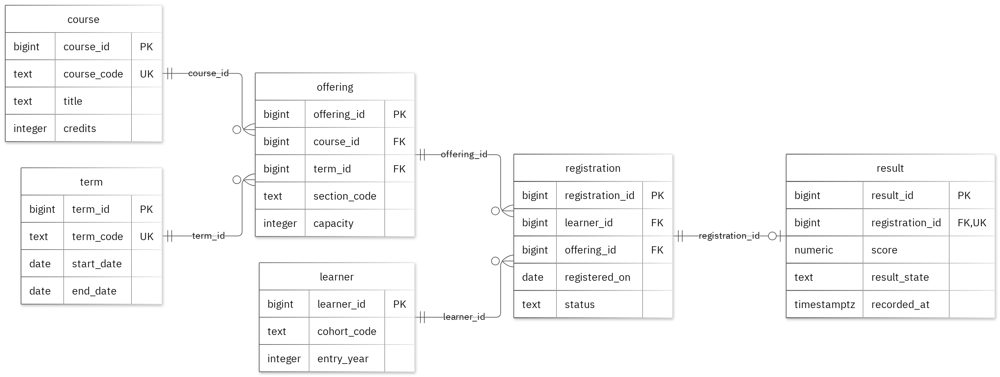

# MIT 8103 Advanced Database Systems

**University / Student Result Portal** · Folawewo Adeyemi · Student ID 301917804

## Case study

The case study I decided to work with is University / Student Result Portal. I designed the database with learners in mind, I want learners to be able to review their registrations and results, while academic staff should be able to manage offerings and record results, with table dedicated to course, term, offering, learner, registration and result. My database supports the following operations: register a learner's course and record the final result; review results by course, term, or score range; benchmark plan: create 20000 synthetic result rows, compare the same score-range filer with and without a B-tree index on result.score, and verify both plans return equivalent rows. 

## Portfolio 1: Database Design and Modelling

The relational design was organised into 6 tables. The Primary key is used to identify records, foreign records preserve the links, and checks enforce the stated business rules. For each learner and offering pair, it is important to note that one registration may have active status, withdrawn or completed registrations do not occupy this partial unique key. The normalisation examples show the various sample data at 1NF, 2NF and 3NF. All 20 invalid inserts were deliberately rejected without changing the sample valid rows.

Figure 1. Tables, keys and relationships. PK: primary key; FK: foreign key; UK: unique value.

<!-- PAGE BREAK -->

## Portfolio 2: Query Processing and Optimisation

I ran three SQL queries against the sample records. The join returned 2 rows and included SYN-C1 with A1. For the index comparison, I used 20,000 separate performance rows. The median lookup time updated from 1.594 ms to 0.171 ms. Both phases returned the same records. The measured plan used the new index. The timings remain unique to the current lookup and system setup.

## Portfolio 3: Transactions and Concurrency

During registration, a short term counter was created during registration to test a number of things, like the commit, rollback, and read committed isolation processes. The other session could not see uncommited changes, The rolling back feature was able to restore previously recorded value. When a lock wasn't used, the counter was updated by both sessions, resulting in a completed value of 2. However, when SELECT FOR UPDATE was applied, Session A finished its update before Session B could commence its own update resulting in a final value of 3. This helper was used specially for this exercise, and the original business data remained unchanged.

## Portfolio 4: NoSQL and Advanced Data Models

The event documents for the case were saved in the result_events documents. MongoDB was able to successfully store two sample events, and the expected results were returned by the four queries. During Validation, the system was able to reject entries with wrong data types and repeated event IDs. Embedded snapshots is used to store related information alongside event, while details can vary depending on the event. This exercise uses fictional events and Postgre SQL still sustains its usual relational rules and constraints.

## Repository and evidence

https://github.com/Folawewo7804/Adeyemi_Folawewo_301917804

The portfolio folders include the following; SQL and Javascript files, explanations, query execution plans, result tables, and supporting screenshots.

<!-- PAGE BREAK -->

## Portfolio 5: Distributed and Cloud Database Exercise

To improve system availability, my proposal includes three MongoDB database instances across separate availability zones. The discussion also covered how primary elections work, majority acknowledgements, delays in secondary replication, and the advantages and disadvantages of using sharding for the results-event collections. The purpose of replication is to keep the database available, while backup ensures we can recover the data when needed. To ensure availability, PostgreSQL needs a distinct plan, It is important to note that no replica or failover testing was carried out in this project.

## Individual reflection

I used distinct tables to store the course, term, offering, learner, registration, result information to avoid irrelevant repetition and make the records easier to handle. Each learner and course offering can have just one active registration status at a time. Completed or Withdrawn Registrations do not count towards this restriction because of the partial unique key. I used constraints test to confirm that all required values were provided and that the records were connected correctly. The two session exercise demonstrated how two sessions can read exact value before either one saves its changes, which can lead to one update being lost. Locking the row before reading and updating ensures that both increments are properly recorded. The index comparison illustrates the importance of reviewing execution plans rather than focusing on the final query results alone. It is possible for two queries to return exact results but require varied amounts of processing time and database resources.

## AI-use declaration

I made use of Github Copilot and the portfolio generator to help with preparing the database models, scripts and explanations. The generator was also used to run the PostgreSQL and MongoDB exercises, verified the outputs and obtain screenshots of the results. I was accountable for reviewing the work, ensuring the correctness and explaining the results in the submission.

## References

- [PostgreSQL: constraints](https://www.postgresql.org/docs/17/ddl-constraints.html)
- [PostgreSQL: EXPLAIN](https://www.postgresql.org/docs/17/using-explain.html)
- [PostgreSQL: isolation](https://www.postgresql.org/docs/17/transaction-iso.html)
- [PostgreSQL: row locks](https://www.postgresql.org/docs/17/explicit-locking.html)
- [MongoDB: data modelling](https://www.mongodb.com/docs/manual/data-modeling/)
- [MongoDB: replication](https://www.mongodb.com/docs/manual/replication/)
- [MongoDB: sharding](https://www.mongodb.com/docs/manual/sharding/)
- [Mermaid: ER diagrams](https://mermaid.js.org/syntax/entityRelationshipDiagram.html)

